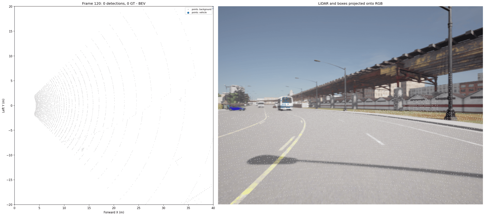
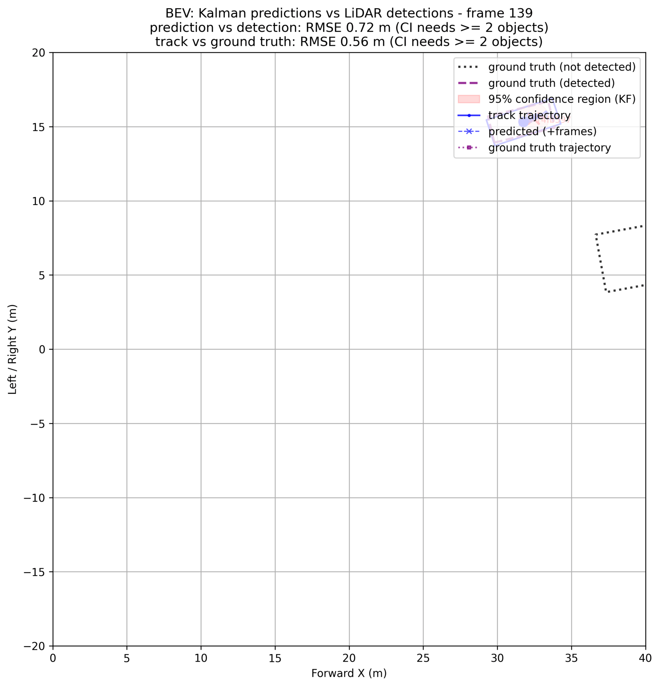
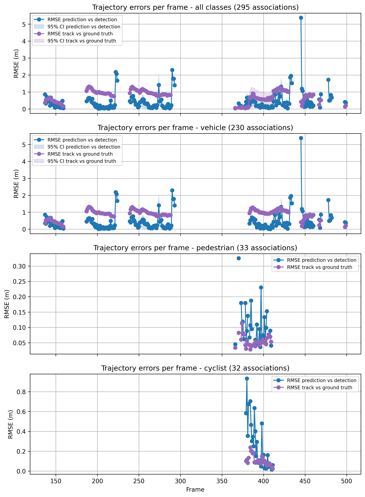
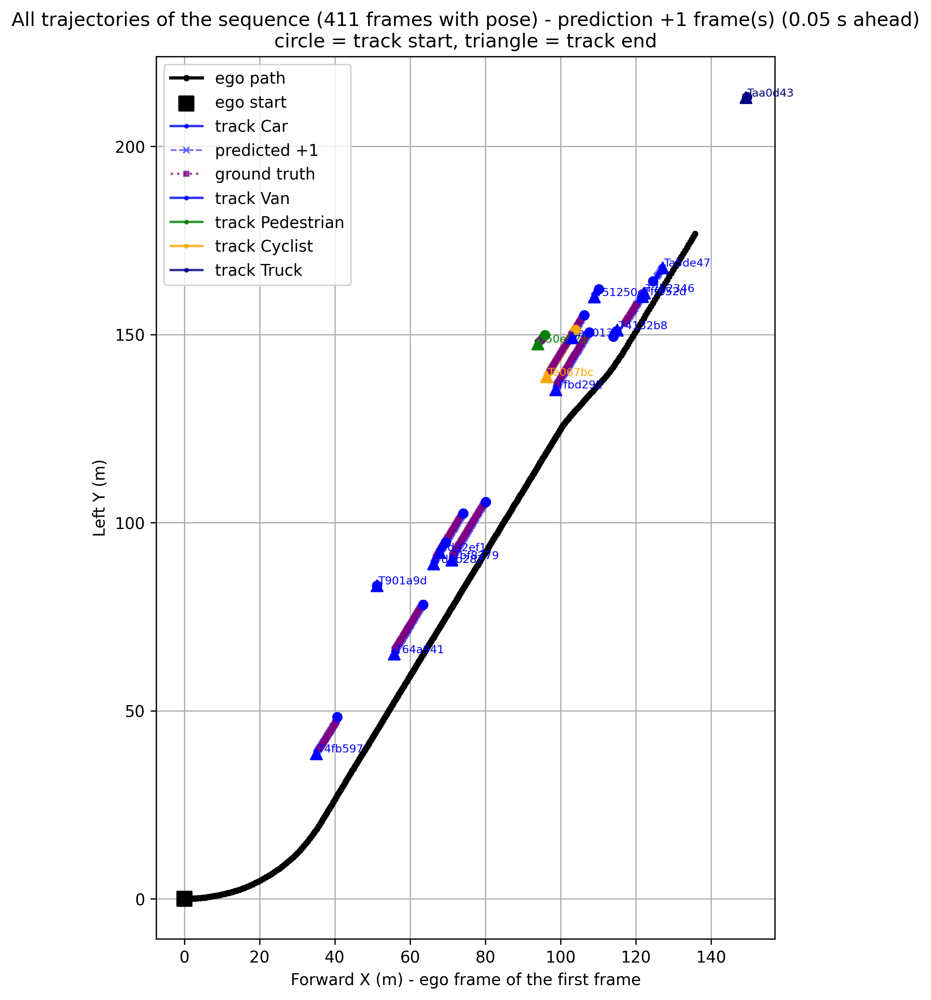
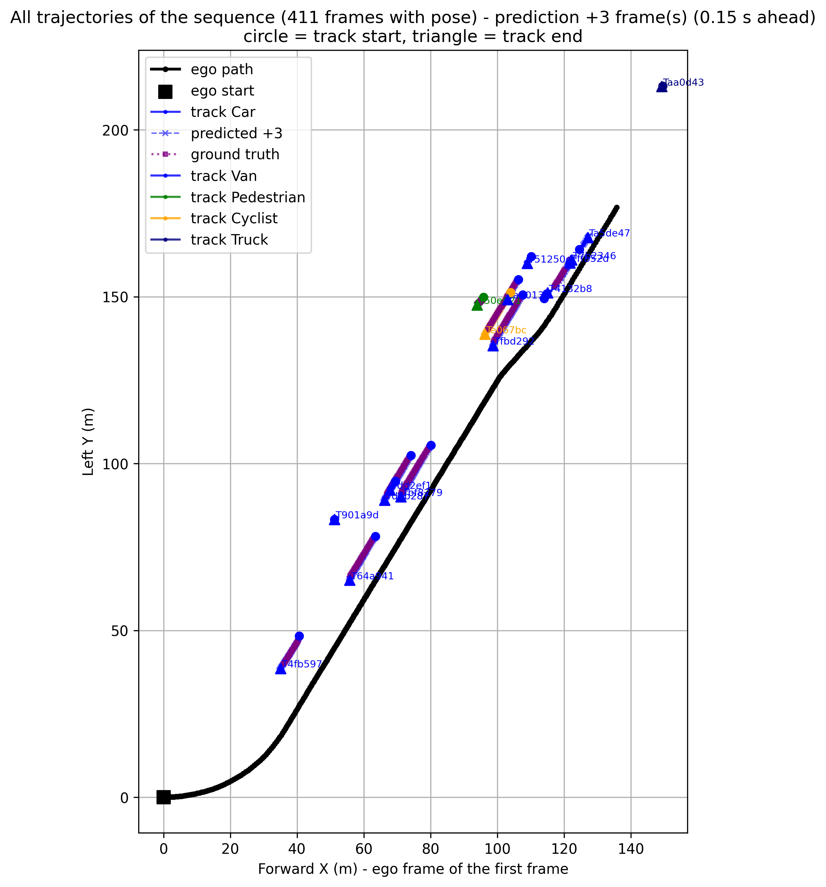
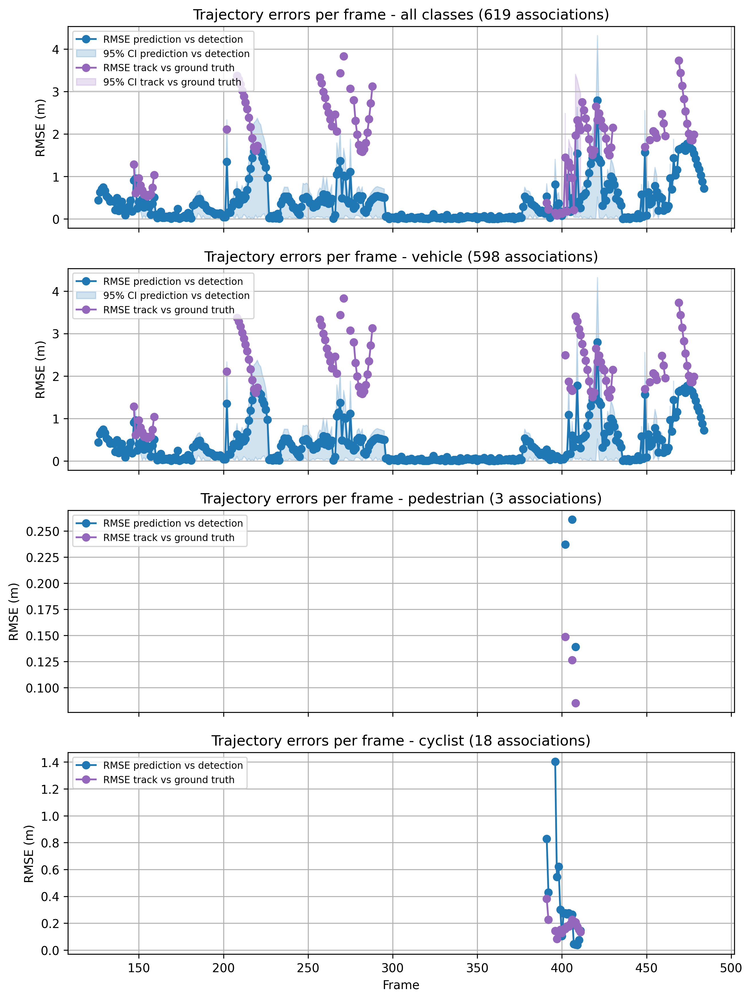
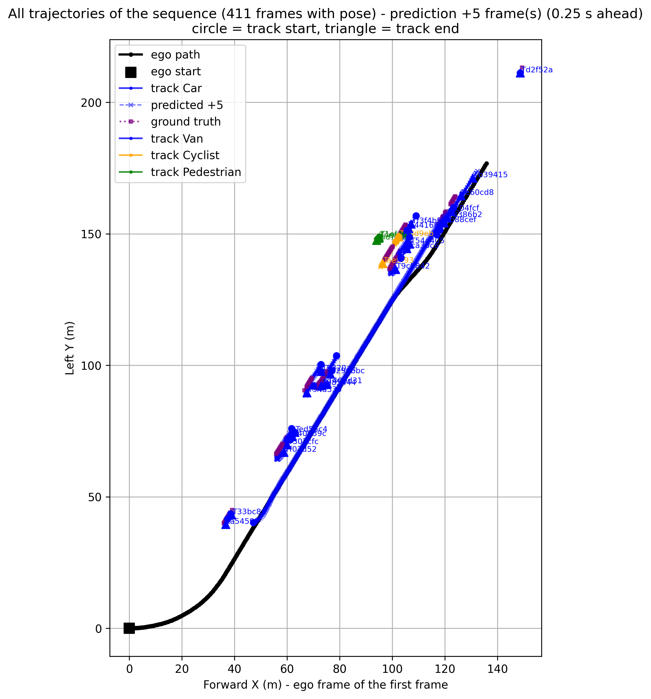

# Object Detection, Tracking and Trajectory Prediction (CARLA)

This project detects road users (cars, vans, cyclists, pedestrians) from LiDAR and a semantic camera, tracks them over time with a Kalman filter, and predicts their position at **t+1, t+3 and t+5 frames** (0.05 s, 0.15 s and 0.25 s ahead at 20 Hz).

It compares two detection front-ends that use the same tracker:

| | Detector | Tracking / prediction |
| --- | --- | --- |
| **Algorithm 1 (baseline)** | Semantic LiDAR + DBSCAN clustering | Constant-velocity Kalman filter |
| **Algorithm 2** | PointPainting + PointPillars (CenterPoint-style head) | Constant-velocity Kalman filter |

**Key results**

- Detection: PointPillars raises overall F1 from **0.087 to 0.552** (BEV IoU ≥ 0.3). Its F1 stays above 0.5 at IoU ≥ 0.5, where DBSCAN drops to 0.010.
- Prediction (PointPillars): vehicle RMSE against ground truth is **1.08 / 1.39 / 1.70 m** at +1 / +3 / +5 frames. For pedestrians it is **0.09 / 0.11 / 0.18 m**. Kalman beats a constant-position baseline everywhere (1.48 vs 2.52 m overall at +5) and a plain constant-velocity baseline for pedestrians and cyclists.
- Tracking (PointPillars): MOTA **0.32**, IDF1 **0.55**, only 2 ID switches. Misses dominate the errors.
- Main limitation: van recall is low (~0.35), and vans make up 76% of the ground-truth objects.

---

## Table of contents

1. [Data](#1-data)
2. [Algorithm 1: DBSCAN detection (baseline)](#2-algorithm-1-dbscan-detection-baseline)
3. [Algorithm 2: PointPainting + PointPillars](#3-algorithm-2-pointpainting--pointpillars)
4. [Tracking and prediction: Kalman filter](#4-tracking-and-prediction-kalman-filter)
5. [Results](#5-results)
6. [Limitations and next steps](#6-limitations-and-next-steps)

---

## 1. Data

All data comes from the [CARLA](https://carla.org/) simulator and is recorded at **20 Hz**. The ego vehicle provides:

- an RGB / semantic camera,
- a LiDAR point cloud,
- ego poses (used to track in the world frame),
- ground-truth 3D boxes for evaluation.

| Front camera | LiDAR (bird's-eye view) |
| --- | --- |
|  |  |

**Evaluation set**: one sequence of 411 frames with ego pose.

| Class | Ground-truth objects |
| --- | --- |
| Van | 512 |
| Pedestrian | 71 |
| Cyclist | 61 |
| Car | 30 |
| **Total** | **674** |

**Scenario settings**

| Setting | Value |
| --- | --- |
| Town | Town02 |
| Weather | ClearNoon |
| Scenario length | 1000 frames (50 s at 20 Hz) |

> pointpillar has been trained over 3000 frames, using sevral towns, lightning condition
---

## 2. Algorithm 1: DBSCAN detection (baseline)

1. The semantic camera labels are projected onto the LiDAR points.
2. Points from the classes of interest are clustered in BEV with DBSCAN.
3. A box is fitted to each cluster, and its class comes from the semantic label.

**Paramètres DBSCAN**
```
DBSCAN_EPS = 0.6
DBSCAN_MIN_SAMPLES = 3
```
| Semantic camera + LiDAR | BEV DBSCAN clusters |
| --- | --- |
|  |  |

---

## 3. Algorithm 2: PointPainting + PointPillars

1. **PointPainting** projects each LiDAR point into the semantic camera image and appends the point's class as a one-hot vector. This step involves no learning; it only adds the camera semantics to the point cloud:

   ```
   (x, y, z, intensity) -> (x, y, z, intensity, background, vehicle, pedestrian, two_wheeler)
   ```

2. **[PointPillars](https://arxiv.org/abs/1812.05784)**  groups the painted points into vertical columns (pillars, 0.16 m) on a BEV grid and encodes them. A 2D CNN then predicts 3D boxes. The head is **CenterPoint-style** (a heatmap of object centres plus box regression) rather than anchor-based, so there are no per-class anchor sizes to tune.



### Training augmentations

These are applied in this order to every training frame:

| # | Augmentation | Purpose |
| --- | --- | --- |
| 1 | GT sampling | Paste objects (points + box) cut from other training frames, at their original position, to get more instances of rare classes (Van, Truck, Cyclist) |
| 2 | Object noise | Move / rotate each object (box + its points) slightly |
| 3 | Global flip | Left / right (y → −y) |
| 4 | Global rotation | Around the LiDAR z axis |
| 5 | Global scaling | |
| 6 | Global translation | |
| 7 | Point dropout | Remove random points (sparser LiDAR) |
| 8 | Semantic noise | Erase the painted class of random points or whole objects: CARLA semantics are perfect, real (or predicted) segmentation is not |

### Training

The model is trained for **40 epochs**. The loss has three terms: the centre **heatmap** loss, the box **regression** loss, and an **uncertainty** term (it goes negative, as a learned-variance / negative log-likelihood term can).

| Epoch | Train total | Train heatmap | Train reg. | Val total | Val heatmap | Val reg. |
| --- | --- | --- | --- | --- | --- | --- |
| 1 | 2.953 | 2.349 | 2.972 | 2.987 | 2.674 | 2.017 |
| 10 | 0.373 | 0.282 | 1.332 | 0.709 | 0.559 | 1.462 |
| 20 | 0.194 | 0.199 | 1.039 | 0.523 | 0.436 | 1.276 |
| 30 | 0.043 | 0.139 | 0.801 | 0.412 | 0.351 | 1.123 |
| **34** | −0.004 | 0.122 | 0.721 | **0.373** | **0.348** | **0.958** |
| **40 (used)** | −0.032 | 0.113 | 0.676 | 0.391 | 0.371 | 0.958 |

- Validation loss is noisy until ~epoch 20 (e.g. a spike at epoch 9) and plateaus from ~epoch 29. The best epoch is 34.
- There is a clear **train / validation gap** at the end: the heatmap loss is 0.11 on train vs 0.37 on validation, and the regression loss 0.68 vs 0.96. The uncertainty term keeps decreasing on train (−3.14) but stays around −2.2 on validation. The model fits the training frames much better than unseen ones and becomes over-confident on them.

All results in this readme use the **final checkpoint (epoch 40)**. Its validation loss (0.391) is close to the best epoch (0.373), so picking epoch 34 instead would change little.

> Trained over 3,000 frames, learning rate set to 2e-3, optimized with AdamW

---

## 4. Tracking and prediction: Kalman filter

Both detectors use the same tracker.

**State.** Each track holds `[x, vx, y, vy]` (position in m, velocity in m/s) and a 4×4 covariance. By default tracking runs in the **world frame** using the ego poses. Otherwise a parked car would appear to move at minus the ego's speed.

**Measurement.** Only the box centroid `(x, y)` is used, with 0.5 m noise. The detector's yaw, box size and score are not used. Velocity is never measured directly; the filter infers it from successive positions.

**Motion model.** Each axis uses a constant-velocity model:

```
x' = x + vx·Δt        vx' = vx        (same for y)
```

Acceleration is modelled as white noise with spectral density 0.5 m²/s³. Predictions follow a straight line, and their uncertainty grows with Δt.

**Each frame:**

1. Predict every track to the current frame.
2. Associate tracks and detections using the Mahalanobis distance (gate = 5), plus a semantic gate (e.g. a car track cannot match a pedestrian detection). Each track gets at most one detection (global nearest neighbour).
3. Update the matched tracks. A track unmatched for more than `MAX_MISSED_FRAMES = 3` frames is deleted. An unmatched detection starts a new track with zero velocity and high velocity variance (10).
4. **Predict ahead**: from each track's current state, predict to t+h for h = 1, 3, 5 (0.05 / 0.15 / 0.25 s). These predictions are stored, not fed back into the track. When frame t+h arrives, they are compared with the matched detection and with the ground truth to give the RMSE per horizon.

---

## 5. Results

### 5.1 Detection: DBSCAN vs PointPillars

Pooled TP / FP / FN over the sequence, with 95% bootstrap confidence intervals.

**Overall (all classes)**

| Matching criterion | DBSCAN P / R / F1 | PointPillars P / R / F1 |
| --- | --- | --- |
| BEV centroid ≤ 1.0 m | 0.054 / 0.054 / 0.054 | 0.807 / 0.372 / **0.510** |
| BEV IoU ≥ 0.3 | 0.087 / 0.087 / 0.087 | 0.875 / 0.404 / **0.552** |
| BEV IoU ≥ 0.5 | 0.011 / 0.010 / 0.010 | 0.826 / 0.381 / **0.522** |

**Per-class F1 (BEV IoU ≥ 0.3)**

| Class | DBSCAN F1 (95% CI) | PointPillars F1 (95% CI) |
| --- | --- | --- |
| Car | 0.465 [0.267, 0.649] | 0.658 [0.524, 0.777] |
| Cyclist | 0.272 [0.145, 0.396] | 0.702 [0.592, 0.804] |
| Pedestrian | 0.078 [0.000, 0.170] | 0.590 [0.460, 0.703] |
| Van | 0.060 [0.042, 0.079] | 0.516 [0.481, 0.550] |
| **Macro (4 classes)** | **0.219** | **0.617** |

> Ground-truth counts differ slightly between the two runs (Car: 26 vs 30, total: 670 vs 674). PointPillars also predicts one Truck (a false positive with no ground truth), which is excluded from the macro average.

**Observations**

- DBSCAN almost never produces a van box that overlaps the ground truth. Its van F1 only rises at loose distance thresholds (0.33 at ≤ 4 m), which suggests clusters are badly centred and fragmented on large vehicles.
- PointPillars has **high precision but low recall**. Cyclists and pedestrians reach 0.9–1.0 precision but only ~0.4–0.5 recall.
- PointPillars van centres show a systematic offset: at a centroid threshold of 0.5 m van recall is 0.016, but at 1.0 m it is 0.309. At IoU ≥ 0.5 recall is still 0.352, so the boxes overlap well but their centres are shifted by roughly 0.5–1 m.
- Car precision (0.53) is low compared with car recall (0.87). Some vans are probably detected as cars.

<details>
<summary><b>Full detection tables: PointPillars</b></summary>

#### BEV centroid ≤ 0.5 m

| Class | GT | TP | FP | FN | Precision (95% CI) | Recall (95% CI) | F1 (95% CI) |
| --- | --- | --- | --- | --- | --- | --- | --- |
| Car | 30 | 25 | 24 | 5 | 0.510 [0.375, 0.676] | 0.833 [0.694, 0.952] | 0.633 [0.500, 0.765] |
| Cyclist | 61 | 31 | 2 | 30 | 0.939 [0.842, 1.000] | 0.508 [0.390, 0.641] | 0.660 [0.537, 0.769] |
| Pedestrian | 71 | 34 | 0 | 37 | 1.000 [1.000, 1.000] | 0.479 [0.368, 0.594] | 0.648 [0.538, 0.745] |
| Van | 512 | 8 | 186 | 504 | 0.041 [0.015, 0.067] | 0.016 [0.006, 0.026] | 0.023 [0.008, 0.038] |
| Truck | 0 | 0 | 1 | 0 | — | — | — |
| **All** | 674 | 98 | 213 | 576 | 0.315 [0.263, 0.368] | 0.145 [0.118, 0.172] | 0.199 [0.164, 0.234] |

#### BEV centroid ≤ 1.0 m

| Class | GT | TP | FP | FN | Precision (95% CI) | Recall (95% CI) | F1 (95% CI) |
| --- | --- | --- | --- | --- | --- | --- | --- |
| Car | 30 | 26 | 23 | 4 | 0.531 [0.388, 0.672] | 0.867 [0.722, 0.971] | 0.658 [0.516, 0.771] |
| Cyclist | 61 | 33 | 0 | 28 | 1.000 [1.000, 1.000] | 0.541 [0.415, 0.660] | 0.702 [0.587, 0.795] |
| Pedestrian | 71 | 34 | 0 | 37 | 1.000 [1.000, 1.000] | 0.479 [0.369, 0.606] | 0.648 [0.539, 0.755] |
| Van | 512 | 158 | 36 | 354 | 0.814 [0.760, 0.870] | 0.309 [0.279, 0.342] | 0.448 [0.409, 0.487] |
| Truck | 0 | 0 | 1 | 0 | — | — | — |
| **All** | 674 | 251 | 60 | 423 | 0.807 [0.761, 0.850] | 0.372 [0.341, 0.400] | 0.510 [0.472, 0.542] |

#### 3D IoU ≥ 0.3

| Class | GT | TP | FP | FN | Precision (95% CI) | Recall (95% CI) | F1 (95% CI) |
| --- | --- | --- | --- | --- | --- | --- | --- |
| Car | 30 | 26 | 23 | 4 | 0.531 [0.391, 0.667] | 0.867 [0.725, 0.974] | 0.658 [0.532, 0.769] |
| Cyclist | 61 | 33 | 0 | 28 | 1.000 [1.000, 1.000] | 0.541 [0.413, 0.667] | 0.702 [0.585, 0.800] |
| Pedestrian | 71 | 30 | 4 | 41 | 0.882 [0.757, 0.974] | 0.423 [0.310, 0.534] | 0.571 [0.450, 0.681] |
| Van | 512 | 182 | 12 | 330 | 0.938 [0.907, 0.970] | 0.355 [0.324, 0.386] | 0.516 [0.480, 0.549] |
| Truck | 0 | 0 | 1 | 0 | — | — | — |
| **All** | 674 | 271 | 40 | 403 | 0.871 [0.832, 0.906] | 0.402 [0.372, 0.431] | 0.550 [0.516, 0.581] |

#### 3D IoU ≥ 0.5

| Class | GT | TP | FP | FN | Precision (95% CI) | Recall (95% CI) | F1 (95% CI) |
| --- | --- | --- | --- | --- | --- | --- | --- |
| Car | 30 | 26 | 23 | 4 | 0.531 [0.393, 0.667] | 0.867 [0.750, 0.973] | 0.658 [0.530, 0.769] |
| Cyclist | 61 | 23 | 10 | 38 | 0.697 [0.540, 0.857] | 0.377 [0.250, 0.493] | 0.489 [0.347, 0.617] |
| Pedestrian | 71 | 20 | 14 | 51 | 0.588 [0.429, 0.750] | 0.282 [0.182, 0.403] | 0.381 [0.255, 0.514] |
| Van | 512 | 180 | 14 | 332 | 0.928 [0.892, 0.961] | 0.352 [0.322, 0.381] | 0.510 [0.478, 0.541] |
| Truck | 0 | 0 | 1 | 0 | — | — | — |
| **All** | 674 | 249 | 62 | 425 | 0.801 [0.758, 0.841] | 0.369 [0.342, 0.399] | 0.506 [0.474, 0.537] |

3D-centroid results are identical to the BEV-centroid ones. Additional thresholds (2 m, 4 m, IoU ≥ 0.7) are in `res2.txt`.

</details>

<details>
<summary><b>Full detection tables: DBSCAN</b></summary>

#### BEV centroid ≤ 1.0 m

| Class | GT | TP | FP | FN | Precision (95% CI) | Recall (95% CI) | F1 (95% CI) |
| --- | --- | --- | --- | --- | --- | --- | --- |
| Car | 26 | 10 | 7 | 16 | 0.588 [0.375, 0.818] | 0.385 [0.192, 0.577] | 0.465 [0.263, 0.638] |
| Cyclist | 61 | 20 | 0 | 41 | 1.000 [1.000, 1.000] | 0.328 [0.218, 0.450] | 0.494 [0.358, 0.621] |
| Pedestrian | 71 | 6 | 0 | 65 | 1.000 [1.000, 1.000] | 0.085 [0.026, 0.152] | 0.156 [0.050, 0.263] |
| Van | 512 | 0 | 623 | 512 | 0.000 [0.000, 0.000] | 0.000 [0.000, 0.000] | 0.000 [0.000, 0.000] |
| **All** | 670 | 36 | 630 | 634 | 0.054 [0.037, 0.073] | 0.054 [0.037, 0.072] | 0.054 [0.038, 0.073] |

#### BEV centroid ≤ 2.0 m

| Class | GT | TP | FP | FN | Precision (95% CI) | Recall (95% CI) | F1 (95% CI) |
| --- | --- | --- | --- | --- | --- | --- | --- |
| Car | 26 | 14 | 3 | 12 | 0.824 [0.667, 1.000] | 0.538 [0.345, 0.724] | 0.651 [0.470, 0.800] |
| Cyclist | 61 | 20 | 0 | 41 | 1.000 [1.000, 1.000] | 0.328 [0.216, 0.444] | 0.494 [0.355, 0.615] |
| Pedestrian | 71 | 6 | 0 | 65 | 1.000 [1.000, 1.000] | 0.085 [0.029, 0.158] | 0.156 [0.056, 0.273] |
| Van | 512 | 33 | 590 | 479 | 0.053 [0.037, 0.070] | 0.064 [0.044, 0.086] | 0.058 [0.040, 0.077] |
| **All** | 670 | 73 | 593 | 597 | 0.110 [0.087, 0.132] | 0.109 [0.088, 0.131] | 0.109 [0.088, 0.132] |

#### BEV IoU ≥ 0.3

| Class | GT | TP | FP | FN | Precision (95% CI) | Recall (95% CI) | F1 (95% CI) |
| --- | --- | --- | --- | --- | --- | --- | --- |
| Car | 26 | 10 | 7 | 16 | 0.588 [0.333, 0.833] | 0.385 [0.207, 0.563] | 0.465 [0.267, 0.649] |
| Cyclist | 61 | 11 | 9 | 50 | 0.550 [0.333, 0.773] | 0.180 [0.091, 0.277] | 0.272 [0.145, 0.396] |
| Pedestrian | 71 | 3 | 3 | 68 | 0.500 [0.000, 1.000] | 0.042 [0.000, 0.096] | 0.078 [0.000, 0.170] |
| Van | 512 | 34 | 589 | 478 | 0.055 [0.038, 0.073] | 0.066 [0.047, 0.087] | 0.060 [0.042, 0.079] |
| **All** | 670 | 58 | 608 | 612 | 0.087 [0.066, 0.110] | 0.087 [0.067, 0.108] | 0.087 [0.066, 0.109] |

Additional thresholds (0.5 m, 4 m, IoU ≥ 0.5 / 0.7) and per-frame averages are in `res.txt`.

</details>

### 5.2 Trajectory prediction

RMSE between the predicted position and (a) the detection matched at t+h, (b) the ground truth at t+h.

#### PointPillars + Kalman



The Kalman prediction is compared with two baselines on exactly the same samples:

- **Constant position**: the object stays where it is (zero velocity).
- **Constant velocity**: straight-line extrapolation without filtering. (Two-point finite difference)

Δ = RMSE(Kalman) − RMSE(baseline), with a 95% paired bootstrap CI. A negative Δ means Kalman is better; **\*** means the CI of Δ excludes 0.

**RMSE against ground truth (m)**

| Horizon | Class | n | Kalman (95% CI) | Const. position | Const. velocity | Δ vs const. position | Δ vs const. velocity |
| --- | --- | --- | --- | --- | --- | --- | --- |
| **+1** (0.05 s) | Vehicle | 200 | 1.079 [0.995, 1.191] | 1.220 | 0.980 | −0.142 [−0.181, −0.107] \* | +0.099 [+0.036, +0.162] \* |
| | Cyclist | 32 | 0.216 [0.158, 0.275] | 0.327 | 0.390 | −0.111 [−0.166, −0.063] \* | −0.174 [−0.293, −0.058] \* |
| | Pedestrian | 33 | 0.088 [0.060, 0.121] | 0.153 | 0.242 | −0.066 [−0.095, −0.038] \* | −0.154 [−0.230, −0.071] \* |
| | **All** | 265 | 0.941 [0.859, 1.043] | 1.068 | 0.866 | −0.127 [−0.159, −0.097] \* | +0.074 [+0.019, +0.126] \* |
| **+3** (0.15 s) | Vehicle | 184 | 1.386 [1.242, 1.556] | 2.025 | 1.380 | −0.639 [−0.727, −0.556] \* | +0.007 [−0.245, +0.206] |
| | Cyclist | 30 | 0.484 [0.318, 0.633] | 1.090 | 0.785 | −0.607 [−0.775, −0.464] \* | −0.301 [−0.485, −0.120] \* |
| | Pedestrian | 32 | 0.106 [0.079, 0.138] | 0.253 | 0.469 | −0.147 [−0.182, −0.114] \* | −0.363 [−0.484, −0.236] \* |
| | **All** | 246 | 1.211 [1.078, 1.365] | 1.795 | 1.236 | −0.583 [−0.662, −0.506] \* | −0.024 [−0.235, +0.139] |
| **+5** (0.25 s) | Vehicle | 169 | 1.699 [1.493, 1.907] | 2.828 | 1.851 | −1.129 [−1.272, −0.990] \* | −0.152 [−0.606, +0.222] |
| | Cyclist | 28 | 0.744 [0.472, 0.976] | 1.855 | 1.314 | −1.112 [−1.396, −0.862] \* | −0.571 [−0.913, −0.256] \* |
| | Pedestrian | 32 | 0.182 [0.107, 0.246] | 0.378 | 0.756 | −0.197 [−0.262, −0.146] \* | −0.575 [−0.762, −0.389] \* |
| | **All** | 229 | 1.484 [1.308, 1.669] | 2.519 | 1.679 | −1.034 [−1.159, −0.912] \* | −0.195 [−0.607, +0.108] |

<details>
<summary><b>RMSE against the matched detection</b></summary>

| Horizon | Class | n | Kalman (95% CI) | Const. position | Const. velocity | Δ vs const. position | Δ vs const. velocity |
| --- | --- | --- | --- | --- | --- | --- | --- |
| **+1** (0.05 s) | Vehicle | 230 | 0.696 [0.535, 0.882] | 0.632 | 0.652 | +0.064 [+0.006, +0.137] \* | +0.044 [−0.013, +0.114] |
| | Cyclist | 32 | 0.345 [0.245, 0.440] | 0.465 | 0.398 | −0.120 [−0.193, −0.059] \* | −0.052 [−0.165, +0.049] |
| | Pedestrian | 33 | 0.119 [0.090, 0.148] | 0.164 | 0.258 | −0.046 [−0.068, −0.025] \* | −0.139 [−0.215, −0.060] \* |
| | **All** | 295 | 0.627 [0.471, 0.809] | 0.582 | 0.597 | +0.045 [−0.013, +0.102] | +0.029 [−0.020, +0.089] |
| **+3** (0.15 s) | Vehicle | 210 | 1.084 [0.846, 1.311] | 1.392 | 1.270 | −0.307 [−0.421, −0.219] \* | −0.186 [−0.396, −0.004] \* |
| | Cyclist | 30 | 0.571 [0.395, 0.734] | 1.210 | 0.800 | −0.639 [−0.806, −0.491] \* | −0.229 [−0.417, −0.036] \* |
| | Pedestrian | 32 | 0.126 [0.097, 0.156] | 0.247 | 0.485 | −0.121 [−0.154, −0.087] \* | −0.359 [−0.479, −0.234] \* |
| | **All** | 272 | 0.972 [0.781, 1.170] | 1.290 | 1.159 | −0.318 [−0.414, −0.239] \* | −0.187 [−0.378, −0.037] \* |
| **+5** (0.25 s) | Vehicle | 192 | 1.382 [1.143, 1.645] | 2.117 | 1.710 | −0.734 [−0.891, −0.602] \* | −0.327 [−0.700, −0.038] \* |
| | Cyclist | 28 | 0.820 [0.555, 1.053] | 1.968 | 1.321 | −1.148 [−1.423, −0.895] \* | −0.501 [−0.828, −0.202] \* |
| | Pedestrian | 32 | 0.180 [0.120, 0.238] | 0.361 | 0.776 | −0.181 [−0.237, −0.132] \* | −0.597 [−0.773, −0.409] \* |
| | **All** | 252 | 1.239 [1.025, 1.463] | 1.965 | 1.580 | −0.726 [−0.876, −0.593] \* | −0.341 [−0.669, −0.092] \* |

</details>

**Observations**

- **Kalman vs constant position**: Kalman is significantly better against ground truth for every class and horizon, and the gap grows with the horizon (1.48 vs 2.52 m overall at +5). At +1 frame against the detection the two are close, since objects barely move in 0.05 s.
- **Kalman vs constant velocity**:
  - For **pedestrians and cyclists**, Kalman is clearly better at every horizon. Unfiltered velocity estimates are noisy for small, slow objects.
  - For **vehicles**, constant velocity is slightly better at +1 frame against ground truth (0.98 vs 1.08 m). At +3 and +5 frames the two are statistically tied.
- Vehicle RMSE against ground truth is already ~1–1.2 m at +1 frame for *all three* predictors, when a vehicle can barely move. The per-frame plot below shows tracks staying close to their detections (~0.1–0.3 m) but 0.8–1.3 m from the ground truth. Most of the vehicle error therefore comes from the **detector's centre offset**, not from the motion model.
- Pedestrian and cyclist results come from a single short segment (frames ~380–410, ~30 samples) and should be read with caution.

**RMSE per frame**



**Aggregated trajectories**

| +1 frame | +3 frames | +5 frames |
| --- | --- | --- |
|  |  |  |

#### DBSCAN + Kalman (baseline)


**RMSE against the matched detection (m), all classes**

| Horizon | n | Kalman (95% CI) | Const. position | Const. velocity | Δ vs const. position | Δ vs const. velocity |
| --- | --- | --- | --- | --- | --- | --- |
| **+1** (0.05 s) | 619 | 0.671 [0.586, 0.753] | 0.584 | 1.029 | +0.087 [+0.031, +0.144] \* | −0.358 [−0.985, +0.189] |
| **+3** (0.15 s) | 594 | 0.877 [0.795, 0.964] | 1.241 | 1.280 | −0.364 [−0.440, −0.288] \* | −0.403 [−0.994, +0.104] |
| **+5** (0.25 s) | 563 | 1.163 [1.053, 1.269] | 2.031 | 1.393 | −0.867 [−0.975, −0.758] \* | −0.229 [−0.562, +0.097] |

**RMSE against ground truth (m), all classes**

| Horizon | n | Kalman (95% CI) | Const. position | Const. velocity | Δ vs const. position | Δ vs const. velocity |
| --- | --- | --- | --- | --- | --- | --- |
| **+1** (0.05 s) | 118 | 2.224 [2.025, 2.438] | 2.027 | 2.155 | +0.197 [+0.112, +0.282] \* | +0.070 [−0.034, +0.175] |
| **+3** (0.15 s) | 109 | 2.293 [2.091, 2.479] | 1.966 | 2.399 | +0.327 [+0.166, +0.486] \* | −0.106 [−0.555, +0.218] |
| **+5** (0.25 s) | 96 | 2.565 [2.347, 2.766] | 2.260 | 2.597 | +0.305 [+0.040, +0.610] \* | −0.032 [−0.420, +0.270] |

> _TODO: add per-class results for DBSCAN._ see kal_db.txt

**Observations**

- **Kalman vs constant position, against the detection**: constant position is better at +1 frame (objects barely move in 0.05 s). From +3 frames on, Kalman is significantly better, and the gap grows with the horizon (1.16 vs 2.03 m at +5).
- **Against ground truth the result reverses**: constant position is significantly better than Kalman at every horizon (2.03 vs 2.22 m at +1, 2.26 vs 2.57 m at +5), unlike with PointPillars. The Kalman filter learns to follow the DBSCAN centroids well, but those centroids drift relative to the real objects, so the velocity it estimates is partly fake. One likely cause: a cluster's centroid is the centre of the *visible* points, which shifts as the viewpoint changes even for a parked car.
- **Errors against ground truth are large (2.3–2.6 m)** and only ~17% of predictions match a GT object (96 of 563 at +5, vs 229 of 252 for PointPillars). Most DBSCAN tracks follow false or badly-placed detections.
- **Kalman vs constant velocity**: the differences are not significant, but the constant-velocity baseline is very unstable (CI of [0.47, 1.63] m at +1). Raw DBSCAN centroids jump when clusters split or merge, and unfiltered velocities amplify these jumps. The Kalman filter smooths them out.
- These DBSCAN numbers should not be compared directly with the PointPillars "All" row: DBSCAN tracks almost only vehicles (see the per-frame plot), and RMSE against detections measures consistency with the detector, not accuracy.

**RMSE per frame**



**Aggregated trajectories**

| +1 frame | +3 frames | +5 frames |
| --- | --- | --- |
|  |  |  |

### 5.3 Tracking metrics (PointPillars + Kalman)

Evaluated over 411 frames. A track matches a GT object if it is within 2.0 m. Only GT objects within 40 m are counted, and both updated and predicted track states are used.

| Class | MOTA | MOTP (m) | IDF1 | IDP | IDR | GT | FN | FP | IDSW | GT ids | Tracks | MT | ML |
| --- | --- | --- | --- | --- | --- | --- | --- | --- | --- | --- | --- | --- | --- |
| Vehicle | 0.250 | 0.912 | 0.491 | 0.683 | 0.383 | 535 | 317 | 82 | 2 | 8 | 14 | 5 | 1 |
| Cyclist | 0.607 | 0.108 | 0.761 | 0.972 | 0.625 | 56 | 21 | 1 | 0 | 2 | 1 | 1 | 1 |
| Pedestrian | 0.667 | 0.055 | 0.800 | 1.000 | 0.667 | 63 | 21 | 0 | 0 | 2 | 1 | 1 | 1 |
| **All** | **0.321** | **0.695** | **0.547** | 0.746 | 0.431 | 654 | 359 | 83 | 2 | 12 | 16 | 7 | 3 |

- **MOTA** = 1 − (FN + FP + IDSW) / (number of GT objects), summed over all frames. The best score is 1, and it can be negative when there are many false positives.
- **MOTP**: mean distance between matched tracks and GT objects.
- **IDF1** = 2·IDTP / (number of GT objects + number of track outputs). Each GT identity is assigned to at most one track for the whole sequence, chosen to maximise the number of frames where the two are within the match distance. IDF1 measures how consistently an object keeps the same track ID, while MOTA is dominated by misses and false positives. IDP / IDR are the identity precision / recall.
- **MT / ML**: mostly tracked / mostly lost GT identities.
- **GT identities**: the KITTI-format labels have no persistent ID (their id is just the line number in the file). Each label is given the CARLA actor id of the nearest object in `training/poses/frame_*.json`. The two are always within 6 cm of each other, so the matching is reliable.

**Observations**

- **Misses dominate.** FN = 359 vs FP = 83 overall. For vehicles, 317 of 535 GT objects are missed, which matches the low van recall of the detector.
- **Few ID switches (2), but vehicle tracks are fragmented**: 14 tracks for 8 vehicle identities.
- **MOTP for vehicles is 0.91 m**, consistent with the detector's centre offset seen in 5.1 and 5.2.
- There are only 12 GT identities (2 cyclists, 2 pedestrians), so these numbers have high variance. For cyclists and pedestrians, one of the two identities is never tracked (ML = 1).

---

## 6. Limitations and next steps

**Tracker**

- **Straight lines only**: the filter cannot anticipate turns, braking or acceleration, so error grows with the horizon, especially for turning vehicles.
- **Zero initial velocity**: new tracks give poor predictions for the first few frames, until the velocity estimate settles.
- **No context**: map, lanes, heading and other agents are ignored. Each object is predicted on its own.
- **Same noise for every class**: pedestrians and cars share the same process noise (0.5) and measurement noise (0.5 m).

**Detector**

- Low recall, mostly on vans, which dominate the ground truth.
- A systematic ~0.5–1 m centre offset on vans, which carries straight into the tracking error.
- Likely confusion between cars and vans.

**Next steps/opening**

- Reduce the PointPillars train / validation gap (more varied training data: other towns and weathers, stronger regularisation, early stopping).
- Investigate the van centre offset (box origin convention, length regression).
- Lower the score threshold and add a confusion matrix.
- Run the tracker on **ground-truth boxes**, to separate detection error from prediction error.
- Compute per-class / ground-truth prediction results and MOT metrics for DBSCAN too.
- Initialise track velocity from the first two detections, and tune the noise per class.
- Try CTRV (Constant Turn Rate and Velocity) Model / IMM motion models ((Interacting Multiple Model) Filter) or a learned predictor.
