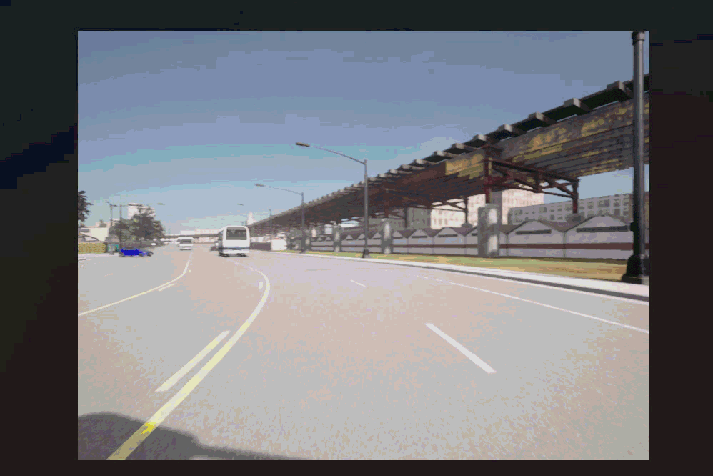
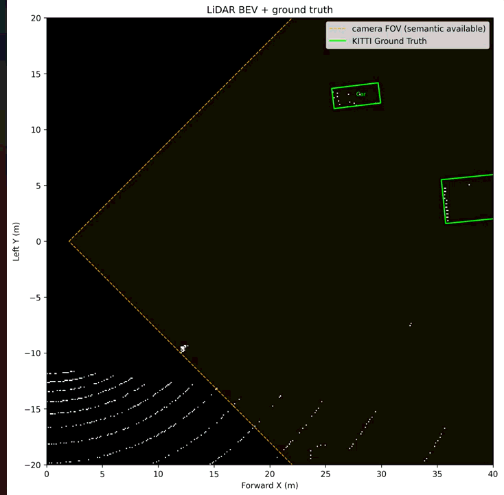
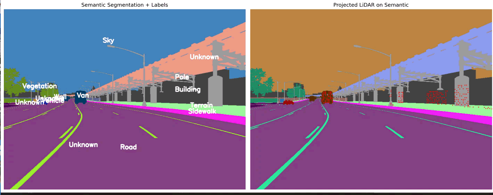
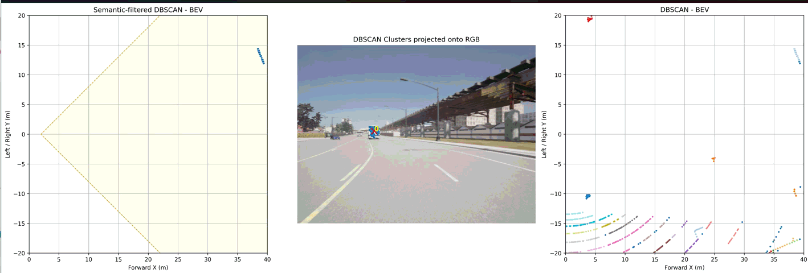
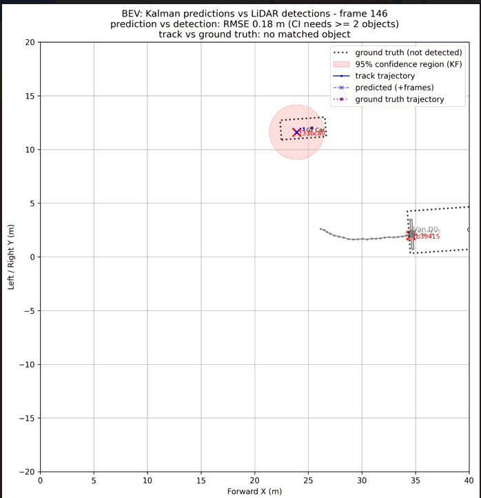

# Tracking algorithms

This repo contains a few vehicles/objects detection tracking algorithms

This work focuses on detecting objects through semantic camera/Lidar, finds boundary boxes, and then predicts the trajectory at time t+1, t+3 and t+5.

## 1. Images taken by the vehicle.
Images and inputs data are taken by Carla simulator. 

Here is an example of the camera of a vehicle. 

Also we have the Lidar data (here with a Bird-eye view representation)

## 2. Algorithms used
## 3. Algorithms 1: DBSCAN and Kalman filter (baseline)
### 3.1. Preprocessing and detection
A semantic segmentation is then provided by the ego vehicle

Below a representation of vehicle detection

### 3.2. Trajectory prediction

