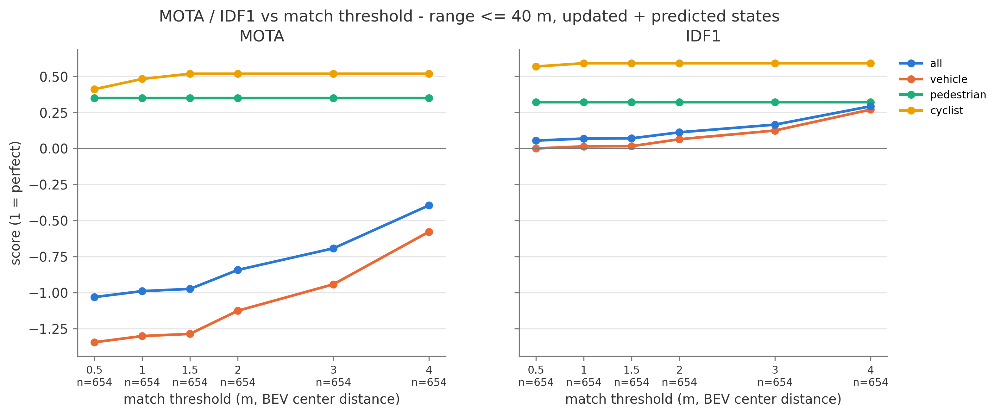
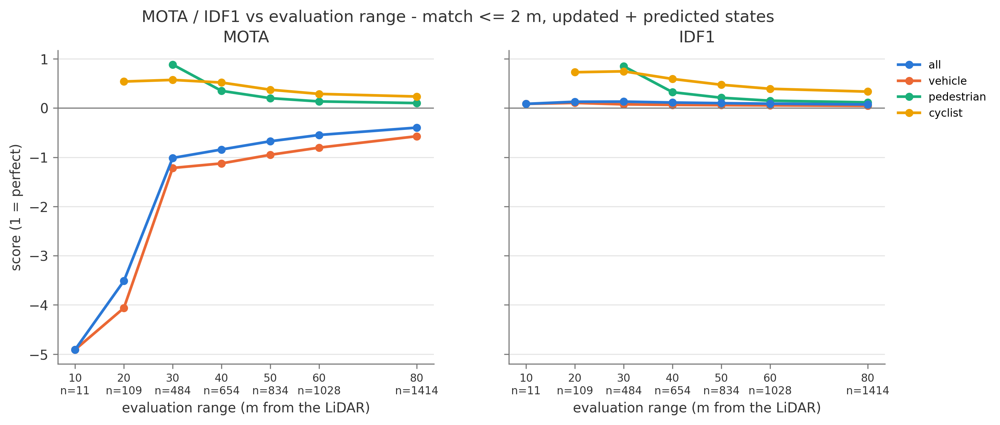
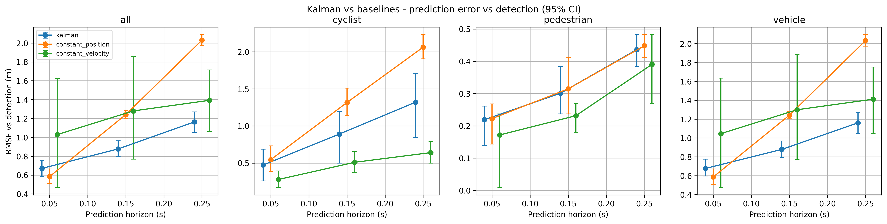
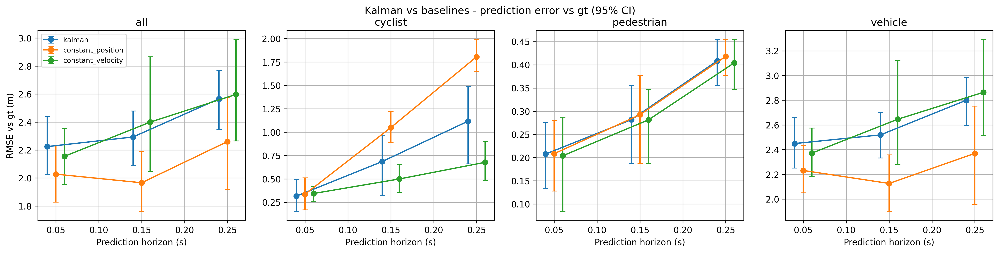
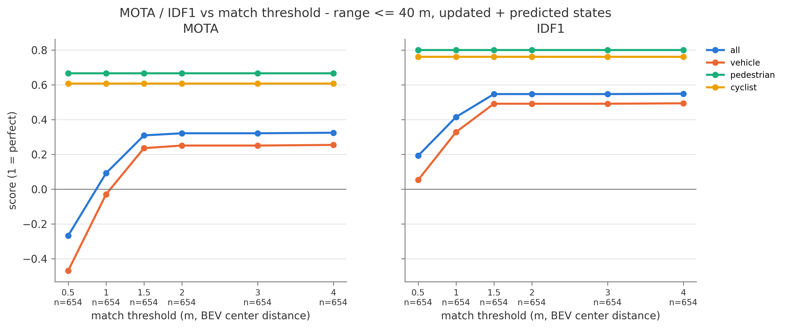
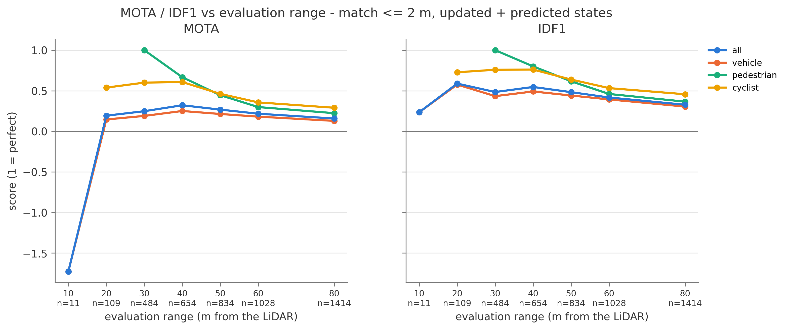

# Tracking algorithms

This repo contains a few vehicles/objects detection tracking algorithms

This work focuses on detecting objects through semantic camera/Lidar, finds boundary boxes, and then predicts the trajectory at time t+1, t+3 and t+5.

**specifications**

- Images are rercorded at 20Hz
- data are converted into a Kitti dataset, and each record has 1.A LIDAR points mapping in 3D and 2. the front camera.  
- Some GT might not be aligned (offset of ~.5m detected)
- Max x is 60 m. This repo will only consider distance for X < 40m, and Y -/+ 20m
## 1. Images taken by the vehicle.
Images and inputs data are taken by Carla simulator. 

Here is an example of the camera of a vehicle. 

Also we have the Lidar data (here with a Bird-eye view representation)

## 2. Algorithms used
### 2.1. Simple clustering apporach

Below there is a simple workflow description:
1. **LiDAR Preprocessing:**
   - Load LiDAR points from KITTI format
   - Filter to ROI using `X_LIMITS` and `Y_LIMITS`
   - Project points to semantic image for labeling

2. **Semantic Filtering:**
   - Apply semantic labels based on `SEMANTIC_MODE`
   - Remove points with "Unknown" labels in strict mode
   - In permissive mode, all points are kept for clustering

3. **DBSCAN Clustering:**
   - Apply DBSCAN with `DBSCAN_EPS` and `DBSCAN_MIN_SAMPLES`
   - Generate cluster labels
   - Noise points get label -1

4. **Semantic Agglomeration (if permissive):**
   - Merge DBSCAN clusters by semantic class
   - Use hierarchical clustering with distance threshold
   - Apply class-based size constraints using `CLASS_MAX_EXTENT`

5. **Bounding Box Fitting:**
   - For clusters with >= `MIN_BOX_POINTS` points
   - Use PCA to determine orientation, and create upright oriented bounding boxes

6. **Ground Truth Matching:**
   - Match detections to GT using `GT_MATCH_MAX_DIST`

### 2.3 Kalman filter

Kalman filter is designed as follow: Each track has a state of 4 numbers, [x, vx, y, vy] (position in metres, velocity in m/s), plus a 4×4 covariance that measures how uncertain that state is.

Input from the detector: only the box centroid (x, y) is used, with 0.5 m of noise 
Velocity: it is never measured directly. The filter infers it from how the position changes over successive frames.

x' = x + vx·Δt        vx' = vx        (same for y)
Acceleration is treated as random noise with a level of 0.5 (m²/s³). So the predicted position follows a straight line, and its uncertainty ellipse grows with Δt.

Associate tracks with detections using the Mahalanobis distance, with a gate of 5. A track with no match for more than ``MAX_MISSED_FRAMES = 3`` frames is deleted. A detection with no match starts a new track with velocity 0 and high velocity uncertainty (variance 10).
Predict ahead : from each track's current state, it runs one prediction to t+h for h = 1, 3, 5. At 20 Hz that is 0.05 s, 0.15 s and 0.25 s ahead. These predictions are only stored, not fed back into the track. When frame t+h arrives, they are compared with the matched detection and with the ground truth, which gives the RMSE per horizon.

**Limitations of current approach**
Straight lines only: it cannot anticipate turns, braking or acceleration, so errors grow with the horizon, especially for vehicles that are turning.
New tracks start at zero speed: their first predictions are poor until the velocity has settled, which takes a few frames.

## 3. Algorithm 1: DBSCAN and Kalman filter (baseline)
### 3.1. Preprocessing and detection
A semantic segmentation is then provided by the ego vehicle

Below a representation of vehicle detection

### 3.2 Detection result
#### Centroids
#### 1. CENTROID BEV — Match distance ≤ 1.0 m

Mean over frames ± standard deviation.

| Class | Frames | Precision | Recall | F1 | IoU | Distance (m) |
| --- | --- | --- | --- | --- | --- | --- |
| Car | 26 | 0.346 ± 0.46 | 0.385 ± 0.49 | 0.359 ± 0.46 | 0.418 | 0.780 |
| Cyclist | 61 | 0.328 ± 0.47 | 0.328 ± 0.47 | 0.328 ± 0.47 | 0.287 | 0.322 |
| Pedestrian | 58 | 0.103 ± 0.30 | 0.078 ± 0.24 | 0.086 ± 0.26 | 0.297 | 0.114 |
| Van | 360 | 0.000 ± 0.00 | 0.000 ± 0.00 | 0.000 ± 0.00 | NaN | NaN |
| ALL | 361 | 0.033 ± 0.11 | 0.029 ± 0.10 | 0.030 ± 0.10 | 0.329 | 0.439 |
| MACRO | — | 0.194 | 0.198 | 0.193 | 0.334 | 0.405 |

#### 2. CENTROID BEV — Match distance ≤ 2.0 m

Mean over frames ± standard deviation.

| Class | Frames | Precision | Recall | F1 | IoU | Distance (m) |
| --- | --- | --- | --- | --- | --- | --- |
| Car | 26 | 0.500 ± 0.48 | 0.538 ± 0.50 | 0.513 ± 0.48 | 0.384 | 0.944 |
| Cyclist | 61 | 0.328 ± 0.47 | 0.328 ± 0.47 | 0.328 ± 0.47 | 0.287 | 0.322 |
| Pedestrian | 58 | 0.103 ± 0.30 | 0.078 ± 0.24 | 0.086 ± 0.26 | 0.297 | 0.114 |
| Van | 360 | 0.044 ± 0.16 | 0.056 ± 0.20 | 0.047 ± 0.16 | 0.109 | 1.772 |
| ALL | 361 | 0.082 ± 0.19 | 0.080 ± 0.19 | 0.078 ± 0.18 | 0.226 | 1.130 |
| MACRO | — | 0.244 | 0.250 | 0.243 | 0.269 | 0.788 |

#### 3. IoU BEV — Match IoU ≥ 0.3

Mean over frames ± standard deviation.

| Class | Frames | Precision | Recall | F1 | IoU | Distance (m) |
| --- | --- | --- | --- | --- | --- | --- |
| Car | 26 | 0.365 ± 0.47 | 0.385 ± 0.49 | 0.372 ± 0.47 | 0.503 | 0.912 |
| Cyclist | 61 | 0.180 ± 0.38 | 0.180 ± 0.38 | 0.180 ± 0.38 | 0.378 | 0.274 |
| Pedestrian | 58 | 0.052 ± 0.22 | 0.052 ± 0.22 | 0.052 ± 0.22 | 0.420 | 0.107 |
| Van | 360 | 0.041 ± 0.13 | 0.044 ± 0.15 | 0.042 ± 0.14 | 0.410 | 2.686 |
| ALL | 361 | 0.064 ± 0.16 | 0.060 ± 0.16 | 0.060 ± 0.15 | 0.422 | 1.843 |
| MACRO | — | 0.160 | 0.165 | 0.161 | 0.428 | 0.995 |

#### 4. 3D Detector — IoU BEV Match IoU ≥ 0.3

95% bootstrap confidence intervals (CI).

| Class | GT | TP | FP | FN | Precision (95% CI) | Recall (95% CI) | F1 (95% CI) |
| --- | --- | --- | --- | --- | --- | --- | --- |
| Car | 26 | 10 | 7 | 16 | 0.588 \[0.333, 0.833\] | 0.385 \[0.207, 0.563\] | 0.465 \[0.267, 0.649\] |
| Cyclist | 61 | 11 | 9 | 50 | 0.550 \[0.333, 0.773\] | 0.180 \[0.091, 0.277\] | 0.272 \[0.145, 0.396\] |
| Pedestrian | 71 | 3 | 3 | 68 | 0.500 \[0.000, 1.000\] | 0.042 \[0.000, 0.096\] | 0.078 \[0.000, 0.170\] |
| Van | 512 | 34 | 589 | 478 | 0.055 \[0.038, 0.073\] | 0.066 \[0.047, 0.087\] | 0.060 \[0.042, 0.079\] |
| ALL | 670 | 58 | 608 | 612 | 0.087 \[0.066, 0.110\] | 0.087 \[0.067, 0.108\] | 0.087 \[0.066, 0.109\] |
| MACRO | — | — | — | — | 0.423 | 0.168 | 0.219 |

### 3.2. Trajectory prediction: plain Kalman filter

### 3.3 Results

**RMSE**

### RMSE Results by Prediction Horizon

#### +1 frame (0.05 s ahead)

| Class | vs Detection RMSE | vs Detection CI | n | vs GT RMSE | vs GT CI | n |
| --- | --- | --- | --- | --- | --- | --- |
| All | 0.440 | \[0.375, 0.520\] | 1217 | 0.998 | \[0.935, 1.067\] | 912 |
| Cyclist | 0.327 | \[0.277, 0.374\] | 127 | 0.340 | \[0.297, 0.384\] | 127 |
| Pedestrian | 0.375 | \[0.154, 0.573\] | 488 | 0.388 | \[0.152, 0.589\] | 444 |
| Vehicle | 0.506 | \[0.472, 0.543\] | 602 | 1.558 | \[1.485, 1.632\] | 341 |

#### +3 frames (0.15 s ahead)

| Class | vs Detection RMSE | vs Detection CI | n | vs GT RMSE | vs GT CI | n |
| --- | --- | --- | --- | --- | --- | --- |
| All | 0.623 | \[0.545, 0.705\] | 1153 | 1.065 | \[0.981, 1.146\] | 871 |
| Cyclist | 0.456 | \[0.379, 0.533\] | 122 | 0.478 | \[0.403, 0.550\] | 122 |
| Pedestrian | 0.516 | \[0.204, 0.750\] | 451 | 0.537 | \[0.207, 0.784\] | 416 |
| Vehicle | 0.722 | \[0.675, 0.768\] | 580 | 1.588 | \[1.505, 1.667\] | 333 |

#### +5 frames (0.25 s ahead)

| Class | vs Detection RMSE | vs Detection CI | n | vs GT RMSE | vs GT CI | n |
| --- | --- | --- | --- | --- | --- | --- |
| All | 0.785 | \[0.717, 0.854\] | 1092 | 1.117 | \[1.026, 1.199\] | 837 |
| Cyclist | 0.635 | \[0.519, 0.742\] | 119 | 0.662 | \[0.549, 0.765\] | 119 |
| Pedestrian | 0.480 | \[0.239, 0.694\] | 418 | 0.501 | \[0.252, 0.730\] | 393 |
| Vehicle | 0.976 | \[0.907, 1.040\] | 555 | 1.657 | \[1.566, 1.755\] | 325 |

Legend:

- RMSE: Root Mean Square Error.
- CI: Confidence interval.
- n: Number of samples.
- vs Detection: Comparison against detections.
- vs GT: Comparison against ground truth.

**Trajectory predictions**
- prediciton at +1 

- prediction at +3 

- prediction at +5

**MOT metrics**:

**Kalman vs baseline (for dbscan -baseline- method)**

## 4. Algorithm 2: pointpainting et pointpillar
### 4.1 Detection: PointPainting and PointPillars

**PointPainting** (`painting.py`): each LiDAR point is projected into the
   semantic camera image and gets its class as a one-hot vector:
   `(x, y, z, intensity) -> (x, y, z, intensity, background, vehicle, pedestrian, two_wheeler)`
**[PointPillars](https://arxiv.org/abs/1812.05784):** in a nutshell, the painted points are grouped into vertical
columns (pillars, 0.16 m) on a BEV grid, encoded, and a 2D CNN predicts
3D boxes. The head is CenterPoint-style (heatmap of object centers +
box regression) instead of the original anchors: simpler, no anchor
sizes to tune per class.

**Training & data augmentation:**

   1. GT sampling       paste objects (points + box) cut from other training
                         frames, at their original position: more instances
                         of the rare classes (Van, Truck, Cyclist)
   2. object noise      move / rotate each object (box + its points) a little
   3. global flip       left / right (y -> -y)
   4. global rotation   around the LiDAR z axis
   5. global scaling
   6. global translation
   7. point dropout     remove random points (sparser LiDAR)
   8. semantic noise    erase the painted class of random points / of whole
                        objects: CARLA semantics are perfect, real (or
                        predicted) segmentation is not

Here an illustration of the algorithm

### 4.2 Detection results

#### 4.2.1. CENTROID 3D — Match distance ≤ 0.5 m

Metric: 95% bootstrap confidence interval (CI)

| Class | GT | TP | FP | FN | Precision (95% CI) | Recall (95% CI) | F1 (95% CI) |
| --- | --- | --- | --- | --- | --- | --- | --- |
| Car | 30 | 25 | 24 | 5 | 0.510 \[0.366, 0.658\] | 0.833 \[0.679, 0.962\] | 0.633 \[0.486, 0.752\] |
| Cyclist | 61 | 31 | 2 | 30 | 0.939 \[0.842, 1.000\] | 0.508 \[0.382, 0.632\] | 0.660 \[0.533, 0.764\] |
| Pedestrian | 71 | 34 | 0 | 37 | 1.000 \[1.000, 1.000\] | 0.479 \[0.365, 0.600\] | 0.648 \[0.534, 0.750\] |
| Truck | 0 | 0 | 1 | 0 | 0.000 \[0.000, 0.000\] | 0.000 \[0.000, 0.000\] | 0.000 \[0.000, 0.000\] |
| Van | 512 | 8 | 186 | 504 | 0.041 \[0.015, 0.073\] | 0.016 \[0.006, 0.027\] | 0.023 \[0.008, 0.040\] |
| ALL | 674 | 98 | 213 | 576 | 0.315 \[0.257, 0.366\] | 0.145 \[0.116, 0.172\] | 0.199 \[0.160, 0.234\] |
| MACRO | — | — | — | — | 0.498 | 0.367 | 0.393 |

#### 4.1.2. CENTROID 3D — Match distance ≤ 1.0 m

Metric: 95% bootstrap confidence interval (CI)

| Class | GT | TP | FP | FN | Precision (95% CI) | Recall (95% CI) | F1 (95% CI) |
| --- | --- | --- | --- | --- | --- | --- | --- |
| Car | 30 | 26 | 23 | 4 | 0.531 \[0.385, 0.667\] | 0.867 \[0.731, 0.970\] | 0.658 \[0.517, 0.767\] |
| Cyclist | 61 | 33 | 0 | 28 | 1.000 \[1.000, 1.000\] | 0.541 \[0.413, 0.667\] | 0.702 \[0.584, 0.800\] |
| Pedestrian | 71 | 34 | 0 | 37 | 1.000 \[1.000, 1.000\] | 0.479 \[0.362, 0.589\] | 0.648 \[0.532, 0.741\] |
| Truck | 0 | 0 | 1 | 0 | 0.000 \[0.000, 0.000\] | 0.000 \[0.000, 0.000\] | 0.000 \[0.000, 0.000\] |
| Van | 512 | 157 | 37 | 355 | 0.809 \[0.754, 0.860\] | 0.307 \[0.274, 0.338\] | 0.445 \[0.404, 0.482\] |
| ALL | 674 | 250 | 61 | 424 | 0.804 \[0.758, 0.847\] | 0.371 \[0.339, 0.400\] | 0.508 \[0.471, 0.541\] |
| MACRO | — | — | — | — | 0.668 | 0.439 | 0.491 |

#### 4.1.3. CENTROID BEV — Match distance ≤ 0.5 m

Metric: 95% bootstrap confidence interval (CI)

| Class | GT | TP | FP | FN | Precision (95% CI) | Recall (95% CI) | F1 (95% CI) |
| --- | --- | --- | --- | --- | --- | --- | --- |
| Car | 30 | 25 | 24 | 5 | 0.510 \[0.375, 0.676\] | 0.833 \[0.694, 0.952\] | 0.633 \[0.500, 0.765\] |
| Cyclist | 61 | 31 | 2 | 30 | 0.939 \[0.842, 1.000\] | 0.508 \[0.390, 0.641\] | 0.660 \[0.537, 0.769\] |
| Pedestrian | 71 | 34 | 0 | 37 | 1.000 \[1.000, 1.000\] | 0.479 \[0.368, 0.594\] | 0.648 \[0.538, 0.745\] |
| Truck | 0 | 0 | 1 | 0 | 0.000 \[0.000, 0.000\] | 0.000 \[0.000, 0.000\] | 0.000 \[0.000, 0.000\] |
| Van | 512 | 8 | 186 | 504 | 0.041 \[0.015, 0.067\] | 0.016 \[0.006, 0.026\] | 0.023 \[0.008, 0.038\] |
| ALL | 674 | 98 | 213 | 576 | 0.315 \[0.263, 0.368\] | 0.145 \[0.118, 0.172\] | 0.199 \[0.164, 0.234\] |
| MACRO | — | — | — | — | 0.498 | 0.367 | 0.393 |

#### 4.1.4. CENTROID BEV — Match distance ≤ 1.0 m

Metric: 95% bootstrap confidence interval (CI)

| Class | GT | TP | FP | FN | Precision (95% CI) | Recall (95% CI) | F1 (95% CI) |
| --- | --- | --- | --- | --- | --- | --- | --- |
| Car | 30 | 26 | 23 | 4 | 0.531 \[0.388, 0.672\] | 0.867 \[0.722, 0.971\] | 0.658 \[0.516, 0.771\] |
| Cyclist | 61 | 33 | 0 | 28 | 1.000 \[1.000, 1.000\] | 0.541 \[0.415, 0.660\] | 0.702 \[0.587, 0.795\] |
| Pedestrian | 71 | 34 | 0 | 37 | 1.000 \[1.000, 1.000\] | 0.479 \[0.369, 0.606\] | 0.648 \[0.539, 0.755\] |
| Truck | 0 | 0 | 1 | 0 | 0.000 \[0.000, 0.000\] | 0.000 \[0.000, 0.000\] | 0.000 \[0.000, 0.000\] |
| Van | 512 | 158 | 36 | 354 | 0.814 \[0.760, 0.870\] | 0.309 \[0.279, 0.342\] | 0.448 \[0.409, 0.487\] |
| ALL | 674 | 251 | 60 | 423 | 0.807 \[0.761, 0.850\] | 0.372 \[0.341, 0.400\] | 0.510 \[0.472, 0.542\] |
| MACRO | — | — | — | — | 0.669 | — | — |

#### 4.1.5. IoU 3D — Match IoU ≥ 0.3

Metric: 95% bootstrap confidence interval (CI)

| Class | GT | TP | FP | FN | Precision (95% CI) | Recall (95% CI) | F1 (95% CI) |
| --- | --- | --- | --- | --- | --- | --- | --- |
| Car | 30 | 26 | 23 | 4 | 0.531 \[0.391, 0.667\] | 0.867 \[0.725, 0.974\] | 0.658 \[0.532, 0.769\] |
| Cyclist | 61 | 33 | 0 | 28 | 1.000 \[1.000, 1.000\] | 0.541 \[0.413, 0.667\] | 0.702 \[0.585, 0.800\] |
| Pedestrian | 71 | 30 | 4 | 41 | 0.882 \[0.757, 0.974\] | 0.423 \[0.310, 0.534\] | 0.571 \[0.450, 0.681\] |
| Truck | 0 | 0 | 1 | 0 | 0.000 \[0.000, 0.000\] | 0.000 \[0.000, 0.000\] | 0.000 \[0.000, 0.000\] |
| Van | 512 | 182 | 12 | 330 | 0.938 \[0.907, 0.970\] | 0.355 \[0.324, 0.386\] | 0.516 \[0.480, 0.549\] |
| ALL | 674 | 271 | 40 | 403 | 0.871 \[0.832, 0.906\] | 0.402 \[0.372, 0.431\] | 0.550 \[0.516, 0.581\] |
| MACRO | — | — | — | — | 0.670 | 0.437 | 0.489 |

#### 4.1.6. IoU 3D — Match IoU ≥ 0.5

Metric: 95% bootstrap confidence interval (CI)

| Class | GT | TP | FP | FN | Precision (95% CI) | Recall (95% CI) | F1 (95% CI) |
| --- | --- | --- | --- | --- | --- | --- | --- |
| Car | 30 | 26 | 23 | 4 | 0.531 \[0.393, 0.667\] | 0.867 \[0.750, 0.973\] | 0.658 \[0.530, 0.769\] |
| Cyclist | 61 | 23 | 10 | 38 | 0.697 \[0.540, 0.857\] | 0.377 \[0.250, 0.493\] | 0.489 \[0.347, 0.617\] |
| Pedestrian | 71 | 20 | 14 | 51 | 0.588 \[0.429, 0.750\] | 0.282 \[0.182, 0.403\] | 0.381 \[0.255, 0.514\] |
| Truck | 0 | 0 | 1 | 0 | 0.000 \[0.000, 0.000\] | 0.000 \[0.000, 0.000\] | 0.000 \[0.000, 0.000\] |
| Van | 512 | 180 | 14 | 332 | 0.928 \[0.892, 0.961\] | 0.352 \[0.322, 0.381\] | 0.510 \[0.478, 0.541\] |
| ALL | 674 | 249 | 62 | 425 | 0.801 \[0.758, 0.841\] | 0.369 \[0.342, 0.399\] | 0.506 \[0.474, 0.537\] |
| MACRO | — | — | — | — | 0.549 | 0.375 | 0.408 |

### 4.3 Prediction results (through Kalman)

#### 4.3.1 Comparing Kalman to baselines (CV & CA)

### +5 frames (0.25 s) — All — VS Detection ($n = 252$)

| Model | RMSE | 95% CI | Kalman − Model | Difference 95% CI | Kalman Better |
| --- | --- | --- | --- | --- | --- |
| Kalman | 1.239 | \[1.025, 1.463\] | — | — | — |
| Constant Position | 1.965 | \[1.849, 2.102\] | −0.726\* | \[−0.876, −0.593\] | 83% |
| Constant Velocity | 1.580 | \[1.259, 1.962\] | −0.341\* | \[−0.669, −0.092\] | 64% |

### +5 frames (0.25 s) — All — vs. Ground Truth ($n = 229$)

| Model | RMSE | 95% CI | Kalman − Model | Difference 95% CI | Kalman Better |
| --- | --- | --- | --- | --- | --- |
| Kalman | 1.484 | \[1.308, 1.669\] | — | — | — |
| Constant Position | 2.519 | \[2.408, 2.637\] | −1.034\* | \[−1.159, −0.912\] | 89% |
| Constant Velocity | 1.679 | \[1.324, 2.101\] | −0.195 | \[−0.607, +0.108\] | 50% |

Note: `*` indicates a statistically significant difference.

#### Prediction Error (RMSE) at Different Future Horizons

#### +1 frame (0.05 s ahead)

| Class | RMSE vs Detection (95% CI) | n | RMSE vs GT (95% CI) | n |
| --- | --- | --- | --- | --- |
| All | 0.627 \[0.471, 0.809\] | 295 | 0.941 \[0.859, 1.043\] | 265 |
| Cyclist | 0.345 \[0.245, 0.440\] | 32 | 0.216 \[0.158, 0.275\] | 32 |
| Pedestrian | 0.119 \[0.090, 0.148\] | 33 | 0.088 \[0.060, 0.121\] | 33 |
| Vehicle | 0.696 \[0.535, 0.882\] | 230 | 1.079 \[0.995, 1.191\] | 200 |

#### +3 frames (0.15 s ahead)

| Class | RMSE vs Detection (95% CI) | n | RMSE vs GT (95% CI) | n |
| --- | --- | --- | --- | --- |
| All | 0.972 \[0.781, 1.170\] | 272 | 1.211 \[1.078, 1.365\] | 246 |
| Cyclist | 0.571 \[0.395, 0.734\] | 30 | 0.484 \[0.318, 0.633\] | 30 |
| Pedestrian | 0.126 \[0.097, 0.156\] | 32 | 0.106 \[0.079, 0.138\] | 32 |
| Vehicle | 1.084 \[0.846, 1.311\] | 210 | 1.386 \[1.242, 1.556\] | 184 |

#### +5 frames (0.25 s ahead)

| Class | RMSE vs Detection (95% CI) | n | RMSE vs GT (95% CI) | n |
| --- | --- | --- | --- | --- |
| All | 1.239 \[1.025, 1.463\] | 252 | 1.484 \[1.308, 1.669\] | 229 |
| Cyclist | 0.820 \[0.555, 1.053\] | 28 | 0.744 \[0.472, 0.976\] | 28 |
| Pedestrian | 0.180 \[0.120, 0.238\] | 32 | 0.182 \[0.107, 0.246\] | 32 |
| Vehicle | 1.382 \[1.143, 1.645\] | 192 | 1.699 \[1.493, 1.907\] | 169 |

Notes:

- RMSE: Root Mean Square Error.
- CI: 95% confidence interval.
- `n`: Number of samples.
- GT: Ground truth.

- prediction at +3 

- prediction at +5

#### RMSE, MOTA, IDF1

RMSE through distance

**MOT Metrics: MOTA/IDF1**

Evaluation parameters:

- Frames: 411
- Matching threshold: ≤ 2.0 m
- State handling: Updated + predicted states
- Maximum range: ≤ 40.0 m

| Class | MOTA | MOTP (m) | IDF1 | IDP | IDR | GT | FN | FP | IDSW | GT IDs | Tracks | MT | ML |
| --- | --- | --- | --- | --- | --- | --- | --- | --- | --- | --- | --- | --- | --- |
| All | +0.321 | 0.695 | 0.547 | 0.746 | 0.431 | 654 | 359 | 83 | 2 | 12 | 16 | 7 | 3 |
| Cyclist | +0.607 | 0.108 | 0.761 | 0.972 | 0.625 | 56 | 21 | 1 | 0 | 2 | 1 | 1 | 1 |
| Pedestrian | +0.667 | 0.055 | 0.800 | 1.000 | 0.667 | 63 | 21 | 0 | 0 | 2 | 1 | 1 | 1 |
| Vehicle | +0.250 | 0.912 | 0.491 | 0.683 | 0.383 | 535 | 317 | 82 | 2 | 8 | 14 | 5 | 1 |

